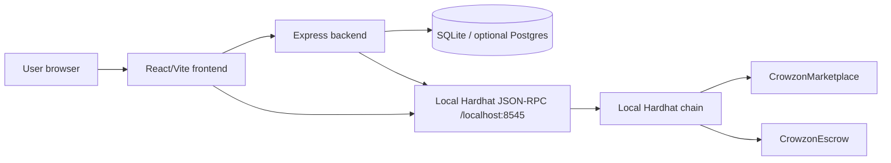
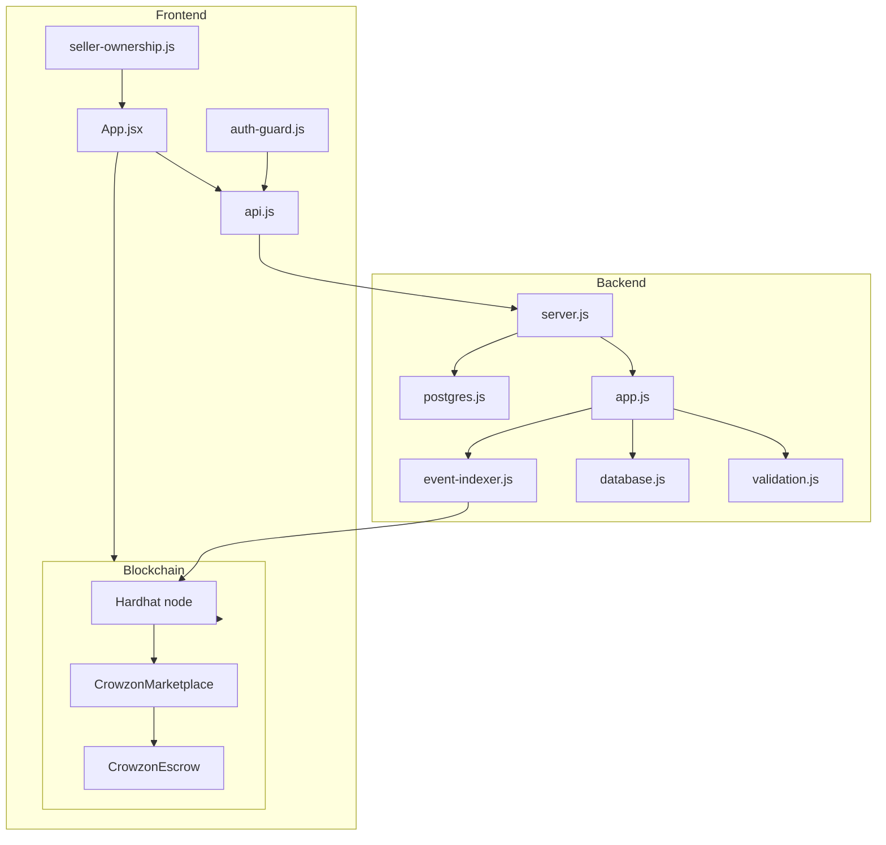
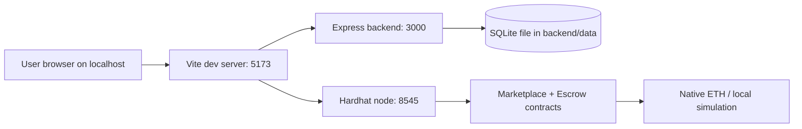
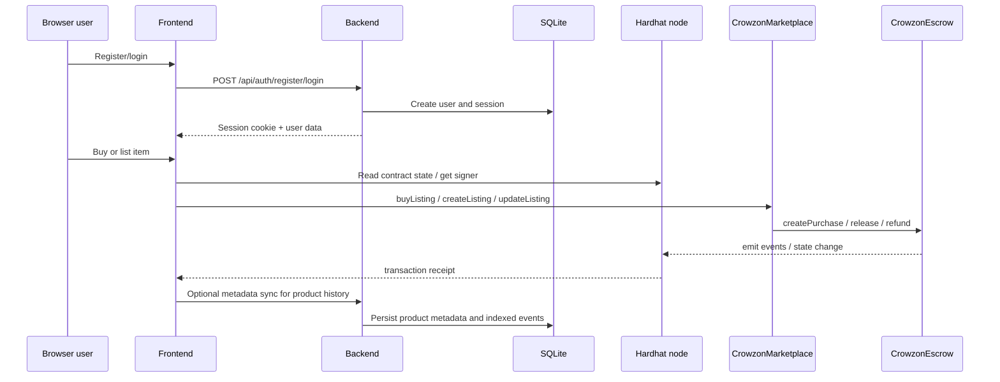
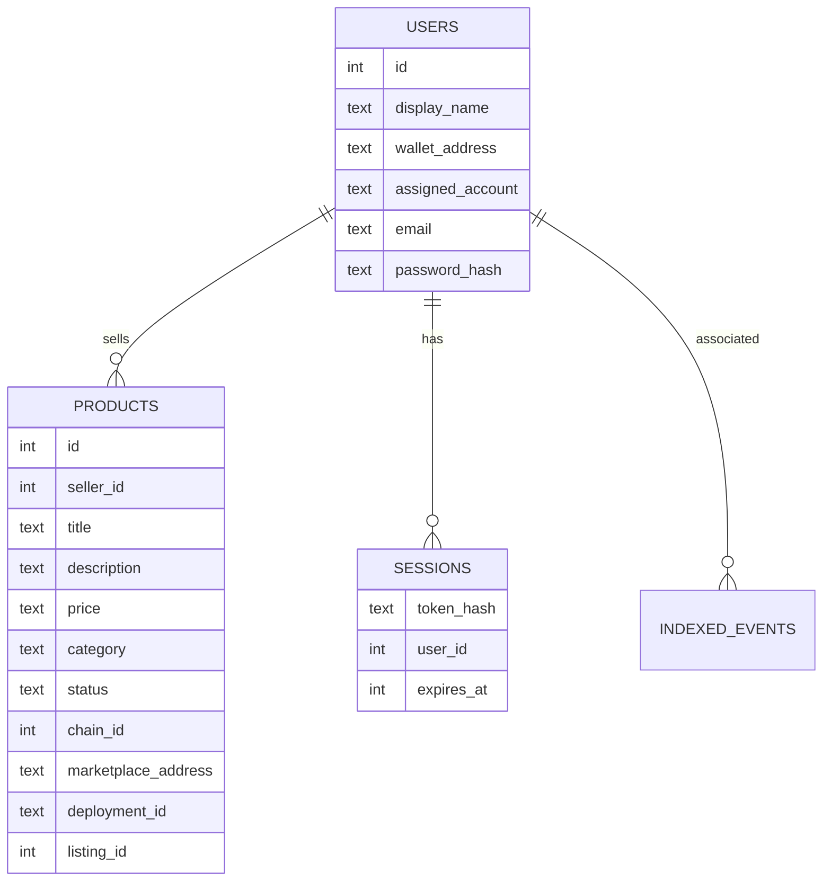
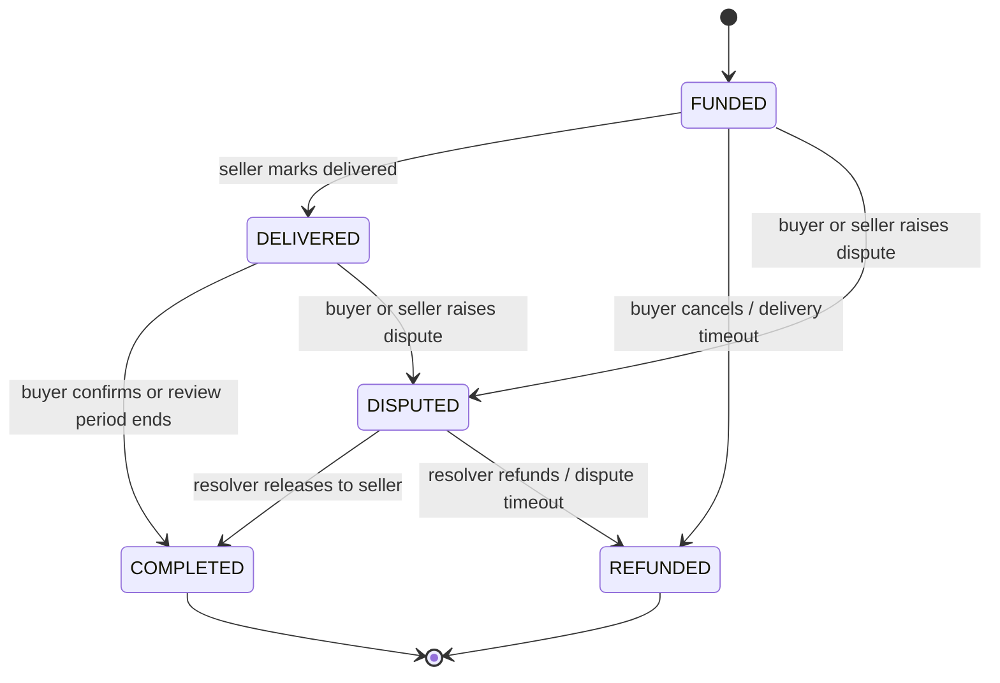
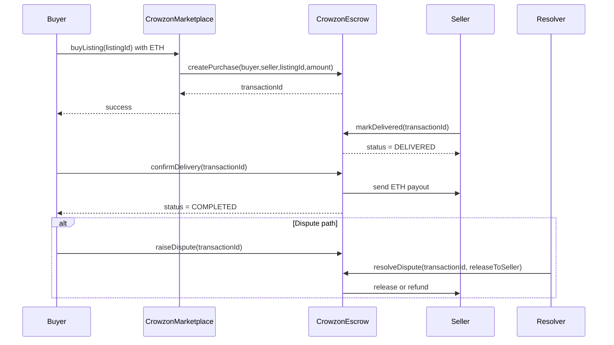

# Crowzon Technical Documentation

This document describes the project as implemented in this repository, not just the original project brief. It is based on the source code in [backend/src](./backend/src), [frontend/src](./frontend/src), [blockchain/contracts](./blockchain/contracts), deployment artifacts, and the automated tests in each workspace.

## 1. Repository map and technology stack

### Project structure

- [README.md](./README.md): root onboarding and startup instructions.
- [backend/](./backend): Express API, SQLite/Postgres abstraction layer, event indexer, auth, validation, and tests.
- [frontend/](./frontend): Vite + React application for the user interface and blockchain interactions.
- [blockchain/](./blockchain): Hardhat project with Solidity contracts, deployment scripts, local deployment artifacts, and contract tests.

### Technology stack

- Frontend: React 19, Vite 8, Ethers v6, CSS modules/embedded component styling.
- Backend: Node.js 22+ runtime, Express 5, Ethers v6, SQLite (Node sqlite API), optional PostgreSQL via `pg`.
- Blockchain: Hardhat 3, Solidity 0.8.28, OpenZeppelin 5.x.
- DB: SQLite is the verified default and active persistence layer. PostgreSQL scaffolding exists in [backend/src/postgres.js](./backend/src/postgres.js), but it is not the default runtime mode.

### Important implementation files

- [backend/src/app.js](./backend/src/app.js): app configuration, auth, session handling, product metadata APIs, assignment enforcement.
- [backend/src/database.js](./backend/src/database.js): SQLite schema, migration logic, and database initialization.
- [backend/src/validation.js](./backend/src/validation.js): request validation for users, auth, and product metadata.
- [backend/src/event-indexer.js](./backend/src/event-indexer.js): local-chain log scanning for marketplace and escrow events.
- [backend/src/postgres.js](./backend/src/postgres.js): PostgreSQL migration SQL and adapter scaffolding.
- [frontend/src/App.jsx](./frontend/src/App.jsx): main application UI and orchestration logic.
- [frontend/src/api.js](./frontend/src/api.js): browser API client for backend calls.
- [frontend/src/blockchain.js](./frontend/src/blockchain.js): local Hardhat RPC connection, contract ABI binding, and wallet helpers.
- [frontend/src/auth-guard.js](./frontend/src/auth-guard.js): session validation for protected operations.
- [frontend/src/seller-ownership.js](./frontend/src/seller-ownership.js): seller metadata and ownership checks.
- [blockchain/contracts/CrowzonMarketplace.sol](./blockchain/contracts/CrowzonMarketplace.sol): native-ETH listing and purchase flow.
- [blockchain/contracts/CrowzonEscrow.sol](./blockchain/contracts/CrowzonEscrow.sol): escrow lifecycle and settlement.
- [blockchain/contracts/CrowzonToken.sol](./blockchain/contracts/CrowzonToken.sol): ERC-20 demo token implementation, not used in the current native-ETH marketplace flow.

## 2. Problem statement and project motivation

Crowzon is designed as a local classroom demonstration of a peer-to-peer marketplace with on-chain settlement and off-chain metadata. The project addresses the typical issue where marketplace data (profiles, listing descriptions, images, seller metadata) is easy to manipulate unless it is anchored to a trusted system.

### Problems in conventional P2P marketplaces

- Sellers and buyers often rely on centralized application-layer verification.
- Payment and delivery trust are separated from the marketplace flow.
- Fraud risk is high when funds are sent before delivery or when ownership is unverifiable.
- Product metadata and seller identity can diverge from actual ownership records.

### Why blockchain is used

The repository uses a local Hardhat chain to model a blockchain-backed marketplace. Listing ownership, pricing, active status, and escrow state are treated as authoritative on-chain facts, while backend metadata is treated as supplemental off-chain context. This lets the application demonstrate trust boundaries explicitly.

### Why escrow is needed

The escrow contract holds buyer funds until the seller completes delivery or the buyer confirms the transaction. This prevents a seller from taking payment without fulfilling the order and protects a buyer from paying without proof of completion. The escrow lifecycle in [blockchain/contracts/CrowzonEscrow.sol](./blockchain/contracts/CrowzonEscrow.sol) includes funding, delivery, delivery confirmation, dispute, and refund paths.

### Why authentication and seller ownership matter

The backend maintains Crowzon user accounts with email/password credentials and separate session cookies. Users are assigned a local development blockchain account from the Hardhat account pool and the app verifies that the authenticated backend user is matched to the correct blockchain seller before allowing metadata updates or on-chain seller-critical actions. The implementation deliberately keeps backend identity and blockchain identity separate and verifies them independently.

### Project goals

- Let users register and sign in to a local marketplace account.
- Bind each profile to a unique local Hardhat development account.
- Browse listings from the local chain.
- Use off-chain metadata to enrich listings without replacing chain truth.
- Demonstrate escrowed ETH settlement on a local blockchain.
- Record local event data in SQLite for order history and activity views.

### Implemented scope

Verified in code and tests:

- Local Hardhat account assignment for up to ten users.
- Authenticated sessions with hashed passwords and cookie-based session tokens.
- Listing metadata CRUD in SQLite.
- Local marketplace listing read operations from the chain.
- Metadata linking by `chainId`, `marketplaceAddress`, `deploymentId`, and `listingId`.
- Native-ETH purchase and escrow settlement.
- Event indexing for marketplace and escrow logs.
- Frontend buyer and seller flows.

### Not a production-grade system

- No HTTPS deployment or public blockchain exposure.
- No rate limiting, admin dashboard, or production session infrastructure.
- No cryptographic wallet ownership verification.
- No production-grade dispute or admin workflow beyond the course demo logic.

## 3. Complete system architecture

### 3.1 System context diagram

### 3.2 Component architecture

### 3.3 Deployment diagram

### 3.4 Interaction diagram

### 3.5 Responsibilities by layer

- Browser: UI state, session handling, contract signing, account selection, local-chain reads, user-facing formatting.
- Backend: user auth, session management, product metadata, validation, SQLite/Postgres persistence, event indexing.
- Database: off-chain user information, sessions, metadata rows, indexed event history.
- Blockchain: listing ownership, price, active state, escrow state, ETH transfers, dispute/finalization logic.

## 4. Frontend implementation

The frontend is implemented in [frontend/src/App.jsx](./frontend/src/App.jsx) and companion files. It builds a single-page application that reflects three major user modes:

- Public marketplace browsing
- Buyer Desk purchase flow
- Seller Studio listing management

### Application entry and initialization

[frontend/src/main.jsx](./frontend/src/main.jsx) mounts the app, and [frontend/src/App.jsx](./frontend/src/App.jsx) initializes the main state model for:

- current authenticated user
- current selected local Hardhat account
- marketplace listings from chain and metadata
- order history and escrow status
- seller ownership metadata checks

The app reads deployment details through the Vite virtual contract import `virtual:crowzon-contracts` and validates that the connected chain is Localhost 31337.

### Authentication flow

- [frontend/src/api.js](./frontend/src/api.js) wraps all backend HTTP calls with same-origin credentials.
- [frontend/src/auth-guard.js](./frontend/src/auth-guard.js) shields protected actions and rejects expired or invalid sessions.
- `register`, `login`, `logout`, and `getCurrentUser` are used from the main UI.

The app treats the backend authentication as an off-chain session. It separately reads and displays the assigned local blockchain account returned by the backend as the user’s `assignedAccount`.

### Buyer Desk and Seller Studio

- Buyer Desk reads listings from the chain and uses metadata matching to supplement product descriptions and seller identity.
- Seller Studio shows only products whose backend `seller_id` matches the current session and checks that the authenticated user’s assigned blockchain address also matches the actual chain seller.
- Mismatch states are surfaced explicitly instead of silently being rewritten.

### Listing metadata flow

- Public listings are loaded through the contract on the local node.
- Off-chain metadata rows are looked up with the tuple `(chainId, marketplaceAddress, deploymentId, listingId)`.
- Seller ownership is validated using both backend ownership and chain seller identity before enabling management actions.

### Purchase flow

For a purchase, the frontend:

1. Validates that the user is authenticated and has a selected account.
2. Resolves the contract signer via `getUnlockedLocalSigner`.
3. Binds the marketplace and escrow contracts using the deployment artifact.
4. Calls `buyListing` with the exact ETH amount.
5. Refreshes the UI and activity data after the transaction.

### Escrow Vault and order history

The app uses the local contract state and backend indexed events to show:

- funded amounts
- delivered/disputed/completed states
- release and refund events
- order history summaries

[frontend/src/escrow-vault.js](./frontend/src/escrow-vault.js) provides summary logic for escrow balances and liabilities. The backend indexer is used for local event history but the frontend displays the current contract state as the authoritative status for the wallet.

### Relevant tests

The frontend test suite validates:

- metadata scoping by deployment
- wallet association behavior
- session enforcement for protected actions
- account selection and ownership mismatches
- summary logic for escrow history

## 5. Backend implementation

### Server startup and configuration

[backend/src/server.js](./backend/src/server.js) bootstraps the application by:

- loading environment variables from `.env`
- selecting SQLite or PostgreSQL via `DATABASE_DRIVER` / `DATABASE_URL`
- validating the configured port
- connecting to the local Hardhat RPC
- reading deployment artifacts from the blockchain workspace
- creating the event indexer
- starting the HTTP server and polling the chain every 5 seconds for new logs

The app refuses to run against a non-local chain and enforces chain ID 31337 for the marketplace deployment and event indexer.

### Express middleware and request lifecycle

In [backend/src/app.js](./backend/src/app.js):

- `express.json({ limit: '32kb', strict: true })` parses JSON.
- cookie-based auth is attached via a middleware that reads the `crowzon_session` cookie and loads the user from the session table.
- the `requireAuth` middleware ensures the user is signed in and that the assigned development account remains valid.
- route-specific validation is applied before all writes.

### Authentication and session logic

- Passwords are hashed with `scrypt` and stored as `scrypt$16384$<salt>$<hash>`.
- Session tokens are random hex strings, stored only as SHA-256 hashes in `sessions.token_hash`.
- Cookies are HttpOnly, SameSite=Lax, and Secure in production.
- Each user can have at most one active session row due to a unique index on `sessions.user_id`.
- Sessions expire after seven days as configured by `SESSION_TTL_MS`.
- logout deletes the server-side session and clears the cookie.

### Account assignment model

The backend assigns a unique local development account from the Hardhat `eth_accounts` pool.

Rules implemented in [backend/src/app.js](./backend/src/app.js):

- pool size must be at least 10
- first 10 unlocked accounts are used
- each user gets a unique assigned account
- existing users are reconciled with available pool accounts and kept if still valid
- assigned accounts are stored in `users.assigned_account`
- unique index prevents duplicate assignment

When a user logs in, the backend ensures their assigned account is still available and reuses it if valid.

### API route inventory

| Method | Endpoint | Purpose | Auth | Notes |
|---|---|---|---|---|
| GET | `/api/health` | Health check and DB connectivity | No | Returns JSON status |
| POST | `/api/auth/register` | Create a user and session | No | Creates assigned account |
| POST | `/api/auth/login` | Sign in and issue session | No | Verifies password hash |
| POST | `/api/auth/logout` | Invalidate session | No | Clears cookie |
| GET | `/api/auth/me` | Fetch current signed-in user | Yes | Requires valid session |
| PUT | `/api/auth/wallet` | Associate selected local wallet with the backend profile | Yes | Unverified identity metadata only |
| GET | `/api/users` | List users or lookup by wallet | No | Supports `?walletAddress=` |
| GET | `/api/users/:id` | Get a specific user | No | Returns public user object |
| GET | `/api/products` | Get product metadata rows | No | Optionally filtered by `status`, `chainId`, `marketplaceAddress`, `deploymentId` |
| GET | `/api/products/:id` | Get one product row | No | Returns metadata record |
| POST | `/api/products` | Create metadata row for a seller | Yes | Requires authenticated owner |
| PATCH | `/api/products/:id` | Update metadata row | Yes | Only owner may modify |
| POST | `/api/products/:id/deactivate` | Deactivate metadata row | Yes | Does not deactivate on-chain listing |
| GET | `/api/products/mine` | List the signed-in seller’s metadata | Yes | Seller Studio feed |
| GET | `/api/orders` | Query indexed escrow history for the authenticated wallet | Yes | Requires profile wallet association |

### Data validation

Detailed validation lives in [backend/src/validation.js](./backend/src/validation.js). Important rules:

- `displayName`: 1-80 chars
- email: RFC-style text, <=254 chars, normalized to lowercase
- password: 1-128 chars for login and registration validation in the current app
- product metadata: title, description, category, price, optional image reference, status, and chain metadata tuple rules
- wallet and marketplace addresses must match `0x` + 40 hex chars
- deployment IDs must match the UUID format in deployment artifacts

### Product metadata and ownership rules

Product metadata rows belong to the authenticated backend user, not to an arbitrary `sellerId` in the request. The app enforces:

- only the current user can patch or deactivate their records
- on-chain seller verification is checked before metadata can be attached to a listing
- metadata is not allowed to mutate chain listing references after creation
- metadata can be created only if the seller identity on the chain matches the session’s assigned account

## 6. Database design

The default database is SQLite, created in [backend/src/database.js](./backend/src/database.js). The schema version is 7 and is upgraded in place.

### Tables

#### users

| Column | Type | Purpose |
|---|---|---|
| id | INTEGER PRIMARY KEY AUTOINCREMENT | User row ID |
| display_name | TEXT | Seller-facing name |
| wallet_address | TEXT UNIQUE | Optional user-associated wallet |
| assigned_account | TEXT UNIQUE | Hardhat account assigned to this profile |
| email | TEXT UNIQUE | Login credential identity |
| password_hash | TEXT | Salted scrypt hash |
| created_at | TEXT | Creation time |
| updated_at | TEXT | Last update time |

#### products

| Column | Type | Purpose |
|---|---|---|
| id | INTEGER PRIMARY KEY AUTOINCREMENT | Product metadata row |
| title | TEXT | Listing title |
| description | TEXT | Product description |
| price | TEXT | Positive decimal string |
| category | TEXT | Product category |
| seller_id | INTEGER FK -> users.id | Metadata owner |
| image_reference | TEXT | Optional relative or HTTP(S) image reference |
| status | TEXT CHECK ('ACTIVE','INACTIVE') | Metadata visibility state |
| chain_id | INTEGER | Local chain ID for linked listing |
| marketplace_address | TEXT | On-chain marketplace address |
| deployment_id | TEXT | Deployment UUID |
| listing_id | INTEGER | On-chain listing ID |
| created_at | TEXT | Created time |
| updated_at | TEXT | Last update time |

Unique index: `(chain_id, marketplace_address, deployment_id, listing_id)` when all four are set.

#### sessions

| Column | Type | Purpose |
|---|---|---|
| token_hash | TEXT PRIMARY KEY | SHA-256 hash of the session token |
| user_id | INTEGER FK -> users.id | Owner of the session |
| expires_at | INTEGER | Expiration timestamp |
| created_at | TEXT | Session creation time |

#### indexed_events

| Column | Type | Purpose |
|---|---|---|
| chain_id | INTEGER | Local chain ID |
| deployment_id | TEXT | Deployment UUID |
| contract_name | TEXT | `marketplace` or `escrow` |
| contract_address | TEXT | Address of the emitting contract |
| transaction_hash | TEXT | Transaction hash |
| log_index | INTEGER | Event log index |
| block_number | INTEGER | Block height |
| event_name | TEXT | Solidity event name |
| listing_id | TEXT | Listing ID as string |
| transaction_id | TEXT | Transaction ID for escrow events |
| buyer_address | TEXT | Buyer address |
| seller_address | TEXT | Seller address |
| actor_address | TEXT | Buyer/seller/resolver depending on event |
| args_json | TEXT | Raw serialized event arguments |

Primary key: `(chain_id, deployment_id, transaction_hash, log_index)`

#### indexer_cursors

| Column | Type | Purpose |
|---|---|---|
| chain_id | INTEGER | Chain identifier |
| deployment_id | TEXT | Deployment UUID |
| contract_address | TEXT | Contract being indexed |
| contract_name | TEXT | Contract role |
| cursor_block | INTEGER | Last processed block |
| updated_at | TEXT | Cursor update time |

### ER diagram

### SQLite migration history

The schema is built in stages in [backend/src/database.js](./backend/src/database.js):

- v1: `users` and `products`
- v2: chain listing metadata fields
- v3: `deployment_id` + unique listing tuple
- v4: email/password/session tables
- v5: indexed event and cursor tables
- v6: unique session per user
- v7: assigned account support

### PostgreSQL scaffolding

[backend/src/postgres.js](./backend/src/postgres.js) includes:

- config parsing for `DATABASE_DRIVER=postgres` and `DATABASE_URL`
- schema creation SQL for equivalent tables
- query rewriting to adapt SQLite-style prepared statements to Postgres
- migration execution helper

This is an implementation scaffold, not a verified production backend. The repo’s default mode, tests, and README all assume SQLite unless a PostgreSQL configuration is intentionally supplied.

## 7. Blockchain and smart contracts

### 7.1 Marketplace contract

File: [blockchain/contracts/CrowzonMarketplace.sol](./blockchain/contracts/CrowzonMarketplace.sol)

Purpose:
- manage listings
- validate the seller and price
- delegate purchase funding to the escrow contract

Key behavior:

- `createListing(string description, uint256 price)` rejects empty description and zero price
- `getListing(uint256 listingId)` returns the listing and reverts if not found
- `updateListing` requires the caller to be the listing seller and the listing to still be active
- `deactivateListing` flips `listing.active` false and emits `ListingDeactivated`
- `buyListing` ensures `msg.value == listing.price`, product is active, buyer is not the seller, and then calls `escrow.createPurchase{value: msg.value}`

Important state:

- `CrowzonEscrow public immutable escrow`
- `uint256 public nextListingId = 1`
- `_listings` mapping stores description, seller, price, active state

### 7.2 Escrow contract

File: [blockchain/contracts/CrowzonEscrow.sol](./blockchain/contracts/CrowzonEscrow.sol)

Purpose:
- hold ETH in escrow for purchases
- enforce delivery windows and review periods
- support payouts, refunds, and disputes

Lifecycle states:

- `FUNDED`
- `DELIVERED`
- `DISPUTED`
- `COMPLETED`
- `REFUNDED`

Important constants:

- `DELIVERY_WINDOW = 7 days`
- `BUYER_REVIEW_PERIOD = 7 days`
- `DISPUTE_RESOLUTION_PERIOD = 30 days`

Important functions:

- `createPurchase(...)`: called only by the marketplace, stores a transaction
- `markDelivered(uint256 id)`: seller marks delivery before the delivery window expires
- `confirmDelivery(uint256 id)`: buyer confirms and releases funds to the seller
- `cancelBeforeDelivery`: buyer cancels while still funded
- `refundUndelivered`: anyone can trigger a refund after delivery window expiry
- `finalizeAfterReviewPeriod`: anyone can finalize a delivered purchase if the buyer has not acted in time
- `raiseDispute`: either buyer or seller can raise a dispute while `FUNDED` or `DELIVERED`
- `resolveDispute`: only the immutable resolver can resolve, releasing to seller or refunding buyer
- `refundUnresolvedDispute`: after dispute timeout, funds are refunded automatically

### 7.3 Token contract

File: [blockchain/contracts/CrowzonToken.sol](./blockchain/contracts/CrowzonToken.sol)

This is an ERC20 demo token with fixed allocations. It is present in the project but does not drive the current native-ETH marketplace implementation. The active native-ETH flow delegates to ETH rather than CVT token transfers.

### 7.4 Escrow state-machine

### 7.5 Transaction lifecycle sequence

### 7.6 Security and correctness notes

- `ReentrancyGuard` is used in both contracts.
- Access-control is enforced by checking sender identities against stored party addresses.
- The marketplace enforces `msg.sender != listing.seller` for purchases and `msg.value == price`.
- Escrow functions revert on invalid state transitions or expiry conditions.
- Funds are moved only after state changes and only after successful low-level calls.
- The resolver is immutable and cannot be changed after deployment.

## 8. User-to-wallet assignment and identity

This is one of the key design elements in the project.

### Assignment mechanism

The backend evaluates the local Hardhat account pool via `eth_accounts` and assigns each registered user a unique development account from the first ten local accounts. This assignment is stored on the user row as `assigned_account` and must remain unique.

### Why the first ten

The application hard-codes the local pool capacity as 10 and treats those as the local demo accounts for account assignment. This matches the documented developer account pool and the test assumptions in [backend/test](./backend/test).

### How it is enforced

- users cannot be assigned duplicate wallets
- account assignments are reconciled on login and registration
- outdated or missing assignments are rejected if the account no longer exists in the active pool
- a signed-in user cannot associate a different profile with another user’s assigned account

### Important identity limitation

The app does not cryptographically prove that the session holder owns the blockchain account. It simply associates a backend user with a local development account for local demo convenience. The backend never treats that address as proof of ownership; contracts enforce actual wallet permissions at execution time.

## 9. Verification and test evidence

The repository includes passing automated tests in each workspace:

- Backend: 33 tests pass
- Blockchain: 17 tests pass
- Frontend: 19 tests pass

This confirms the current codebase demonstrates the intended local flow, including authentication, assignment, metadata binding, and escrow logic.

## 10. Limitations and future improvements

- Replace local demo accounts with a proper wallet-auth flow in production.
- Add HTTPS, rate limiting, session rotation, and stricter abuse protections.
- Add production-safe deployment configuration and environment validation.
- Separate identity verification from off-chain metadata and wallet display.
- Expand dispute tooling and admin controls beyond the course demo.
- Replace SQLite-only assumptions with a fully verified production database deployment strategy.

## 11. Summary

Crowzon is a deliberately local, demo-oriented marketplace that blends:

- React/Vite frontend for UX and transaction orchestration
- Express backend for auth, validation, metadata, and event indexing
- SQLite-first local persistence with a PostgreSQL scaffold
- Hardhat + Solidity contracts for native-ETH marketplace and escrow logic

The central architectural idea is clear: backend metadata and blockchain ownership are separate, and the system is designed to show where each source of truth applies. That separation is visible in the user account assignment flow, listing metadata binding, the escrow lifecycle, and the explicit verification checks in the frontend and backend.
